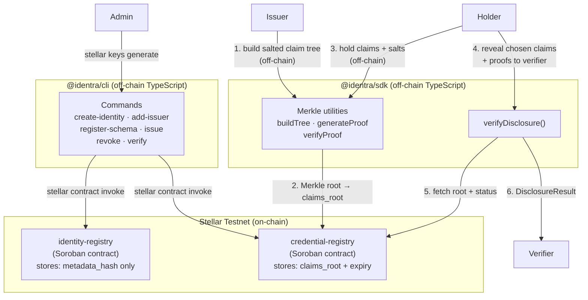

# Architecture

## Overview

Identra is a monorepo with two Soroban smart contracts and a TypeScript SDK + CLI.

## Data flow

### Issuing a credential

1. Issuer builds a salted Merkle tree of claims off-chain using `buildTree()`.
2. Issuer records only the Merkle root, schema id, subject, and expiry on-chain via `credential-registry issue()`.
3. Claim values and salts stay off-chain — held by the subject/holder.

### Verifying a selective disclosure

1. Holder selects which claims to reveal and passes their values, salts, and Merkle proofs to the verifier.
2. Verifier calls `verifyDisclosure()` from the SDK with the revealed data plus the on-chain root (fetched from the contract) and the credential status.
3. The SDK verifies each proof off-chain and returns a `DisclosureResult`.

## Component responsibilities

| Component | Responsibility |
|---|---|
| `identity-registry` | Wallet-linked identity records (metadata hash only). Admin, pause, two-step admin transfer. |
| `credential-registry` | Issuer allowlist, schema registry, credential issuance (root + expiry), revocation, status queries, paged listing. |
| `@identra/sdk` | Merkle tree construction, proof generation, proof verification, `verifyDisclosure`. |
| `@identra/cli` | Human-friendly wrappers around `stellar contract invoke` calls. Uses named Stellar identities. No secret key handling. |

## Storage layout

### identity-registry

| Key | Type | Storage | Description |
|---|---|---|---|
| `Admin` | `Address` | Instance | Current admin |
| `PendingAdmin` | `Address` | Instance | Proposed admin (two-step) |
| `Paused` | `bool` | Instance | Pause flag |
| `NextId` | `u64` | Instance | Next identity id |
| `Identity(id)` | `IdentityRecord` | Persistent | Full identity record |
| `OwnerIndex(addr)` | `u64` | Persistent | Owner address → identity id |

### credential-registry

| Key | Type | Storage | Description |
|---|---|---|---|
| `Admin` | `Address` | Instance | Current admin |
| `Paused` | `bool` | Instance | Pause flag |
| `NextSchemaId` | `u64` | Instance | Next schema id |
| `NextCredId` | `u64` | Instance | Next credential id |
| `Issuer(addr)` | `bool` | Persistent | Approved issuer flag |
| `Schema(id)` | `SchemaRecord` | Persistent | Schema record |
| `Credential(id)` | `CredentialRecord` | Persistent | Credential record |
| `OwnerCreds(addr)` | `Vec<u64>` | Persistent | Subject → credential id list |
| `IdentityRegistry` | `Address` | Instance | Optional identity registry link |
